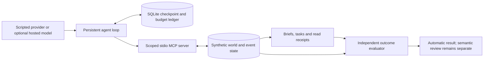

# GoalFlow

**Persistent, inspectable tool-using workflows.** GoalFlow is an agent workflow evaluation lab: a synthetic workplace, a scoped MCP server, a checkpointed agent loop and a separate outcome evaluator. It demonstrates how execution can survive interruption while keeping completion claims and supporting evidence inspectable.

## Run the offline demo

Python 3.12 or 3.13; run from a source checkout. No credentials, model calls, Node or external services are required.

```sh
python3 -m venv .venv
. .venv/bin/activate
python -m pip install -r requirements-offline.lock
python -m scripts.demo
```

The scripted agent requests reviews through real subprocess MCP, exits while waiting, resumes in a different process, publishes and reads back a brief, and receives an evaluator result. A second sequence verifies that a previously valid coding artifact cannot complete revised work. The printed output directory contains SQLite state, traces, artifacts and `summary.json`; use `--output NEW_EMPTY_DIRECTORY` to choose it. These are explicit scripted demonstrations, not autonomous repair or hosted-model results.

## Architecture



The engineering contributions are durable pending-operation replay, bounded execution and spend reservations; run-bound MCP permissions; immutable brief revisions and read-back; source freezes and evidence capture; and a small lifecycle prototype with ownership/revision fencing, event deduplication and atomic continuation intent. See [architecture](docs/ARCHITECTURE.md) for guarantees and boundaries.

## Validate

```sh
python -m pytest -q -p no:cacheprovider
python -m scripts.validate_lifecycle
python -m scripts.demo
python -m scripts.verify_evidence
```

Current release validation: **93 baseline tests and 38/38 GoalFlow lifecycle cells passed** in a freshly installed, relocated macOS/Python 3.13 source tree and clean Linux containers on Python 3.12 and 3.13. The demo and evidence checks also passed on each. GitHub Actions is configured but **has not run**; see [release validation](docs/VALIDATION.md). This is source-tree execution, not a wheel distribution.

## Results and limits

| Evidence | Finding |
| --- | --- |
| Historical hosted-model Step 3 | 10 automatic passes, 2 rejected claims; human review unresolved |
| Separate AI adjudication | One material omission; no recurring shared failure mechanism established |
| Historical scripted lifecycle comparison | 112/112 cells passed across three implementations and two domains |
| Predeclared benefit gate | 8.8% custom-source reduction missed the 30% threshold; framework expansion stopped |

[Evidence index](evidence/README.md) distinguishes current tests, historical records and AI review. Hash verification checks retained bytes; it does not rerun historical studies or establish independent reliability. Complete raw archives remain private. No historical score was changed.

The scheduler and workers are scripted, leases use logical time, and application policy supplies artifact verification and explicit invalidation. Permissions are an application boundary, not an OS sandbox. There is no production reliability, remote exactly-once, human-productivity, novel-framework or generalization claim. Automatic correctness cannot replace semantic review: the demo intentionally ends at `needs_review`.

[Reproduction and optional integrations](docs/REPRODUCTION.md) · [Provenance and license review](docs/PROVENANCE.md) · [Third-party notices](THIRD_PARTY_NOTICES.md) · [Release readiness](RELEASE_READINESS.md)

MIT for independently authored work; upstream code retains its own notices. No public push has been authorized.
